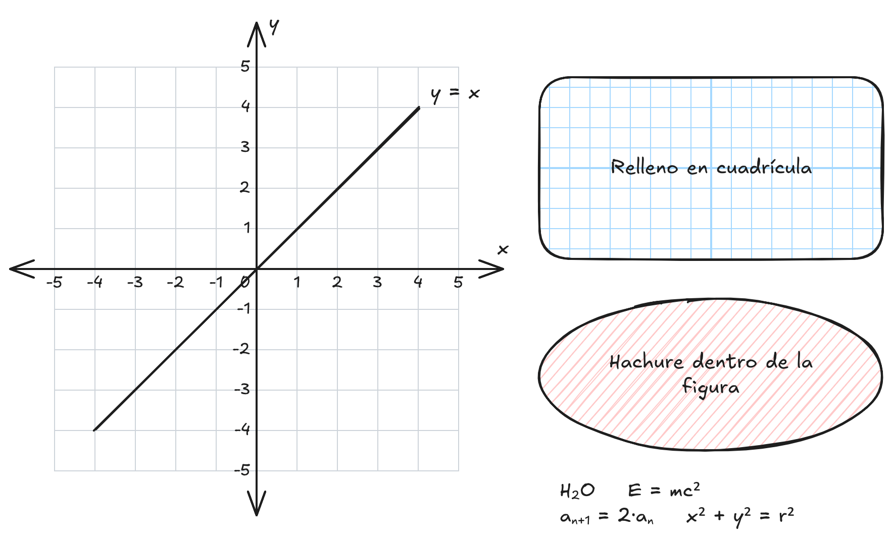

# LittleDraw


Pizarra vectorial **nativa en Rust**, compatible con archivos `.excalidraw`, con un gestor de proyectos y pizarras. Dibuja directamente en la GPU, **sin Chromium ni Electron**.

Reproduce el estilo dibujado a mano, las herramientas y el formato de [Excalidraw](https://github.com/excalidraw/excalidraw), y añade herramientas para dar clase: plano cartesiano, relleno en cuadrícula, subíndices y superíndices.

| Gestor de proyectos | Editor |
|---|---|
|  |  |
|  |  |



<details>
<summary>Más capturas</summary>

**Herramientas, texto y figuras**


**Trazos con presión de lápiz (Wayland)**


**Exportación de `samples/demo.excalidraw`**


</details>

> Las capturas usan datos de ejemplo inventados.

## Características

**Editor**
- Rectángulos, rombos, elipses, líneas y flechas multipunto que se anclan a las figuras, trazo libre, texto e imágenes (PNG, JPEG, GIF, WebP, BMP).
- Texto multilínea con las fuentes de Excalidraw, etiquetas dentro de figuras y selección dentro del texto que se está editando.
- Rellenos `solid`, `hachure`, `cross-hatch`, `zigzag` y `grid`; las líneas del relleno no se salen de la figura.
- Grosor, estilo y rugosidad del trazo, esquinas redondeadas, opacidad, rotación, grupos, capas, deshacer y rehacer.
- Presión real del lápiz en Wayland; con ratón, la presión se simula según la velocidad.
- Tema claro y oscuro, compartido con el gestor.

**Para clases**
- **Plano cartesiano** (tecla `C`): al arrastrar se dibujan la cuadrícula, los ejes con flechas, los números y las etiquetas `x` e `y`. Con `Shift` solo se dibuja el primer cuadrante, y un clic crea un plano de 10 × 10. Las líneas y flechas que se dibujan encima se ajustan a las intersecciones, aunque el plano se mueva o se escale (`Shift` desactiva el ajuste).
- **Relleno en cuadrícula:** celdas de 20 px centradas en la figura, con las líneas centrales más gruesas como ejes.
- **Subíndices y superíndices** mientras se escribe: `Ctrl+=` y `Ctrl++`, como en Word. Se guardan como caracteres Unicode (H₂O, x²), así que el archivo sigue siendo texto plano.

**Gestor de proyectos y pizarras**
- Proyectos con color, pizarras recientes, búsqueda y miniaturas.
- Crear, renombrar, duplicar, mover y eliminar pizarras y proyectos.
- Importar y exportar `.excalidraw`, y exportar imágenes desde el menú de cada pizarra.
- Guardado automático 700 ms después de la última edición.

**Compatibilidad con Excalidraw**
- Abre y guarda `.excalidraw` y conserva los campos que no usa.
- Copia y pega en el formato del portapapeles de Excalidraw.
- El plano cartesiano y las fórmulas son elementos normales de Excalidraw, así que se ven igual allí. El relleno `grid` es propio de LittleDraw: Excalidraw lo muestra como hachure.
- Exporta a PNG y SVG desde la aplicación (`Ctrl+Shift+E`) o desde la línea de comandos.

## Atajos de teclado

| Herramienta | Tecla | | Acción | Atajo |
|---|---|---|---|---|
| Selección | `V` o `1` | | Guardar | `Ctrl+S` |
| Rectángulo | `R` o `2` | | Abrir / Guardar como (archivo suelto) | `Ctrl+O` / `Ctrl+Shift+S` |
| Rombo | `D` o `3` | | Volver al gestor | `Ctrl+B` |
| Elipse | `O` o `4` | | Deshacer / Rehacer | `Ctrl+Z` / `Ctrl+Shift+Z` o `Ctrl+Y` |
| Flecha | `A` o `5` | | Copiar / Cortar / Pegar | `Ctrl+C` / `Ctrl+X` / `Ctrl+V` |
| Línea | `L` o `6` | | Duplicar | `Ctrl+D` |
| Trazo libre | `P` o `7` | | Agrupar / Desagrupar | `Ctrl+G` / `Ctrl+Shift+G` |
| Texto | `T` o `8` | | Zoom / Restablecer zoom | `Ctrl++` `Ctrl+-` / `Ctrl+0` |
| Imagen | `9` | | Exportar imagen | `Ctrl+Shift+E` |
| Plano cartesiano | `C` | | Tema claro u oscuro | `Alt+Shift+D` |
| Mano (desplazar) | `H` o `Espacio` | | Subíndice / Superíndice (al escribir) | `Ctrl+=` / `Ctrl++` |

## Instalación

Por ahora LittleDraw se compila desde el código fuente y está pensado para **Linux** (Wayland o X11). Hace falta [Rust](https://rustup.rs) y una GPU con Vulkan.

```bash
git clone https://github.com/im4dev/LittleDraw
cd LittleDraw
cargo build --release
install -Dm755 target/release/littledraw ~/.local/bin/littledraw

# Opcional: entrada en el menú de aplicaciones
install -Dm644 resources/littledraw.desktop ~/.local/share/applications/littledraw.desktop
install -Dm644 resources/icon.png ~/.local/share/icons/hicolor/512x512/apps/littledraw.png
```

## Uso

```bash
littledraw                          # gestor de proyectos
littledraw dibujo.excalidraw        # abrir un archivo en el editor
littledraw --workspace ~/pizarras   # usar otra carpeta de datos
littledraw --dark                   # forzar el tema en esta ejecución (o --light)

# Exportar sin abrir ventana
littledraw dibujo.excalidraw --svg dibujo.svg --png dibujo.png --scale 2
```

### Dónde se guardan los datos

| Qué | Dónde | Se cambia con |
|---|---|---|
| Proyectos y pizarras | `~/.local/share/littledraw/workspace` (`$XDG_DATA_HOME`) | `--workspace DIR` o `LITTLEDRAW_WORKSPACE` |
| Tema elegido | `~/.config/littledraw/theme` (`$XDG_CONFIG_HOME`) | el botón de tema o `Alt+Shift+D` |

La carpeta de datos contiene `workspace.json` (el índice), `boards/` (una escena `.excalidraw` por pizarra) y `thumbnails/` (las miniaturas). Si existe una carpeta de una versión anterior en `~/.config/Boards/workspace`, se mueve a la nueva ubicación la primera vez y la antigua queda como un enlace a la nueva.

## Estado

- **Plataformas:** Linux. Windows, una demo web y un instalador con actualizaciones automáticas son los próximos pasos.
- **Datos locales:** no hay cuentas ni sincronización en la nube.
- **Cambios:** ver [`CHANGELOG.md`](CHANGELOG.md).

## Desarrollo

La arquitectura, las pruebas y cómo generar las capturas están en [`docs/DEVELOPMENT.md`](docs/DEVELOPMENT.md).

## Licencia y créditos

LittleDraw tiene licencia [MIT](LICENSE).

Se basa en [Excalidraw](https://github.com/excalidraw/excalidraw) (MIT), del que reproduce el diseño, el comportamiento y el formato, y porta algoritmos de [rough.js](https://github.com/rough-stuff/rough) (MIT) y [perfect-freehand](https://github.com/steveruizok/perfect-freehand) (MIT). Las fuentes incluidas tienen licencia SIL OFL 1.1 o MIT. Los avisos completos están en [`THIRD_PARTY_NOTICES.md`](THIRD_PARTY_NOTICES.md).

LittleDraw es un proyecto independiente, sin relación con el equipo de Excalidraw.
